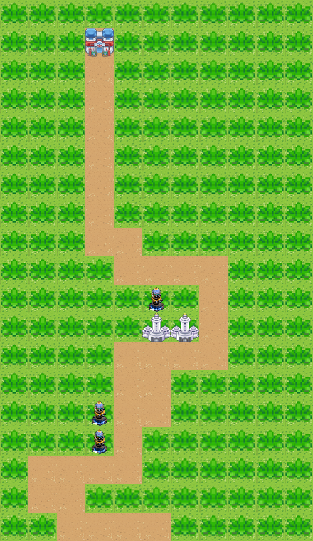

# Tower Defense — C / SDL2

Prototype de simulation Tower Defense : les défenses sont placées automatiquement et les ennemis suivent un parcours aléatoire jusqu'à la tour du roi. Le joueur peut observer la partie, la mettre en pause, sauvegarder, charger ou recommencer.



## Jouer sous Windows

Dans la version Windows prête à lancer, extraire tout le dossier puis ouvrir `tower-defense.exe`. Le dossier `data` et `SDL2.dll` doivent rester à côté de l'exécutable. Le jeu conserve les images du projet d'origine.

| Touche | Action |
|---|---|
| P ou Espace | Pause / reprendre |
| N | Nouvelle partie |
| S / C | Sauvegarder / charger en binaire |
| D / V | Sauvegarder / charger en texte |
| Échap ou fermer la fenêtre | Quitter |

Le titre de la fenêtre indique la vie du roi, l'état de la partie et le résultat des sauvegardes. Après une défaite, appuyer sur N pour recommencer.

Les sauvegardes sont enregistrées dans le dossier personnel de l'application (`%APPDATA%/SangFuu/TowerDefense` sous Windows). Les nouveaux formats versionnés conservent le parcours et toutes les caractéristiques des unités. Les anciennes sauvegardes, qui ne contenaient pas toutes ces informations, sont refusées sans effacer la partie courante.

## Compiler sous Linux

Installer un compilateur C, CMake et les fichiers de développement SDL2, puis :

```sh
sudo apt-get install build-essential cmake libsdl2-dev
cmake -S . -B build -DCMAKE_BUILD_TYPE=Release
cmake --build build
./build/tower-defense
```

## Compiler sous Windows avec MinGW / CLion

Utiliser SDL2 **pour MinGW 64 bits**, puis indiquer son dossier contenant `include/SDL2`, `lib` et `bin` :

```powershell
cmake -S . -B build -G Ninja -DSDL2_ROOT="C:/outils/SDL2/x86_64-w64-mingw32" -DCMAKE_BUILD_TYPE=Release
cmake --build build
./build/tower-defense.exe
```

CMake copie automatiquement les images et, dans cette configuration Windows, SDL2.dll à côté du programme. CLion permet aussi de définir `SDL2_ROOT` dans les options CMake de son profil MinGW. Le chemin SDL2 du projet d'origine était codé pour une autre machine ; il n'est plus utilisé.

## Vérifier

```sh
ctest --test-dir build --output-on-failure -V
```

Les tests vérifient 500 parcours générés avec différentes graines, 40 simulations, les règles de ciblage, les attaques, les sauvegardes texte et binaires, la restitution du parcours et le rejet de fichiers absents, tronqués ou incorrects sans perte de la partie courante. Un test SDL charge les 11 images, dessine 120 étapes et quitte au moyen d'un événement de fermeture. Les graines peuvent produire un même parcours ; les tests vérifient l'absence de cases répétées dans chaque parcours.

Un contrôle automatique Linux avec AddressSanitizer et UndefinedBehaviorSanitizer est défini dans [GitHub Actions](https://github.com/SangFuu/tower-defense/actions).

Pour un essai graphique court et reproductible :

```sh
./build/tower-defense --seed 42 --smoke-test 120 --snapshot apercu.bmp
```

Ce mode de test utilise une fenêtre cachée et ne crée pas de sauvegarde. Le pilote `SDL_VIDEODRIVER=dummy` permet de l'exécuter sans écran.

## Corrections principales

- Erreur de syntaxe empêchant la compilation et allocation incorrecte du plateau.
- Parcours incomplets ou répétés : chaque nouvelle partie comporte maintenant 34 cases voisines et distinctes.
- Ennemi initial placé en dehors du plateau et apparitions empilées sur une case occupée.
- Fuites des listes de ciblage, listes d'unités et surfaces ; suppression des références périmées après un chargement ou un décès.
- Fermeture de fenêtre ignorée, interfaces bloquées par des boîtes de dialogue et pauses dans les animations.
- Sauvegardes incomplètes ou chargées sans contrôle : parcours et statistiques sont conservés, le chargement est validé avant de remplacer la partie courante.

Le format binaire conserve les structures C et vise une même architecture ; le format texte est préférable pour échanger une partie entre plateformes. Les tests couvrent les scénarios décrits, sans garantir une absence absolue de défaut ni la conformité exhaustive à un sujet universitaire.

## Attribution

Les sources retrouvées mentionnent « SAID PAUL » et un second auteur non renseigné. Cette attribution et les images d'origine sont conservées. Aucune licence supplémentaire sur le code ou les images n'est supposée. SDL2 est une dépendance externe, sous licence zlib : [site officiel](https://www.libsdl.org/).


